# IberiaMusic

[](https://github.com/FLMontoya/IberiaMusic/actions/workflows/ci.yml)


App Android de búsqueda de música con pantalla de detalle, hecha con Kotlin y Jetpack Compose.

## Características

- Búsqueda de canciones con debounce de 300 ms; una búsqueda nueva cancela la anterior.
- Caché en memoria por query con TTL de 3 minutos y reloj inyectable.
- Pantalla de detalle con carátula y los campos que devuelve iTunes.
- Estados de carga, vacío y error, con accesibilidad cuidada (TalkBack, fuente al 200 %, contraste y
  teclado).
- Arquitectura en cuatro módulos (`app`, `presentation`, `domain`, `data`) con inyección manual,
  sin Hilt.

## Tecnologías

| Área | Tecnología | Versión |
|---|---|---|
| Lenguaje | Kotlin | 2.3.21 |
| Build | Android Gradle Plugin | 9.5.1 |
| UI | Jetpack Compose (BOM) y Material 3 | 2026.09.00 |
| Navegación | Navigation Compose | 2.10.2 |
| Asincronía | Coroutines y `StateFlow` | 1.11.0 |
| Red | Retrofit y OkHttp | 3.0.0 y 5.5.1 |
| Serialización | kotlinx.serialization | 1.13.0 |
| Imágenes | Coil | 3.6.3 |
| Formato | ktfmt (`com.ncorti.ktfmt.gradle`) | 0.28.0 |
| Tests | JUnit 4, MockK, Turbine, kotlin-test, coroutines-test, MockWebServer y Robolectric | 4.13.2, 1.14.12, 1.2.1, 2.3.21, 1.11.0, 5.5.1 y 4.18.1 |

Android: `minSdk` 26, `targetSdk` y `compileSdk` 37. Las versiones están centralizadas en
`gradle/libs.versions.toml`.

## API elegida

[iTunes Search API](https://itunes.apple.com/search?term=queen&media=music): pública y sin API key.
Se consulta `search?term=...&media=music&entity=song&limit=50`, es decir, solo canciones y un
máximo de 50 resultados. El detalle muestra nombre, artista, álbum, género, duración y fecha de
lanzamiento, junto con la carátula; los campos que iTunes no devuelve se muestran con un guion («-»).

## Cómo ejecutar

### Requisitos previos

- Android Studio reciente, o JDK 25 para la línea de comandos.
- Un emulador o dispositivo con Android 8.0 (API 26) o superior.
- Conexión a internet: la app consulta la API de iTunes en tiempo real.

### Instalación

```bash
./gradlew assembleDebug        # compila la app
./gradlew installDebug         # la instala en un dispositivo o emulador (API 26+)
./gradlew ktfmtCheck test      # formato y tests unitarios (lo mismo que ejecuta el CI)
./gradlew ktfmtFormat          # aplica el formato
./gradlew connectedDebugAndroidTest  # tests de instrumentación de accesibilidad (necesita un emulador)
```

En Windows usa `gradlew.bat` en lugar de `./gradlew`.

Pasos desde cero:

1. Clona el repositorio: `git clone https://github.com/FLMontoya/IberiaMusic.git`.
2. Ábrelo en Android Studio y deja que sincronice Gradle, o usa la línea de comandos.
3. Arranca un emulador (API 26 o superior) o conecta un dispositivo y ejecuta `installDebug`.

El Gradle daemon pide JDK 25 (`gradle/gradle-daemon-jvm.properties`), que el CI también usa.

### Uso

1. Escribe en el campo de búsqueda: los resultados aparecen solos tras una breve pausa, o al pulsar la
   tecla de búsqueda del teclado.
2. Toca una canción para ver su detalle (carátula, artista, álbum, género, duración y fecha).
3. Si la búsqueda falla, pulsa «Reintentar» o la tecla de búsqueda.
4. Vuelve con el botón «Volver» o con el gesto de atrás.

## Arquitectura

Cuatro módulos en la raíz, con esta regla de dependencias:

```
app ──▶ presentation ──▶ domain ◀── data ◀── app
```

| Módulo         | Tipo            | Contenido                                                          |
|----------------|-----------------|--------------------------------------------------------------------|
| `domain`       | Kotlin/JVM      | `Track`, `SearchResult`, `SearchRepository`, `SearchTracksUseCase` |
| `data`         | Kotlin/JVM      | API Retrofit, DTOs, mappers, caché en memoria, repositorio         |
| `presentation` | Android library | `SearchViewModel`, `SearchUiState`, pantallas Compose y tema       |
| `app`          | Application     | Inyección manual de dependencias y navegación                      |

`app` depende de los otros tres; `presentation` y `data` solo dependen de `domain`; `domain` no
depende de nadie y `presentation` nunca depende de `data`. No se usa Hilt: el `AppContainer` de
`app` construye el grafo a mano, una vez por proceso.

Los fallos de red no se lanzan como excepciones: el repositorio devuelve un `SearchResult`
(`Success`, `Empty` o `Error`) y la UI lo traduce a un `SearchUiState` (`Idle`, `Loading`,
`Content`, `Empty` o `Error`) expuesto en un único `StateFlow`.

## Decisiones

### Caché

- Caché en memoria por query, con TTL de 3 minutos contado desde que se guarda la entrada.
- Con caché válida no hay llamada de red. Si la entrada ha expirado, se consulta la red y se
  actualiza la caché. Los errores no se cachean.
- El reloj es una interfaz propia (`TimeProvider`) inyectada en la caché, de modo que los tests
  simulan el paso del tiempo sin esperas. La implementación real usa un reloj monotónico
  (`System.nanoTime()`): atrasar la hora del dispositivo no resucita entradas caducadas, y si el
  reloj retrocede la entrada se trata como caducada.
- La caché guarda como máximo 50 entradas y expulsa la menos usada recientemente. Al escribir se
  purgan las entradas caducadas, aunque no se vuelvan a consultar.
- La clave es la query sin espacios en los extremos y en minúsculas: "Queen", " queen " y "QUEEN"
  comparten entrada.
- Los resultados se deduplican por `id`, porque la lista usa el `id` como clave y debe ser única.
- La caché vive en `AppContainer`, así que sobrevive a cambios de configuración y de pantalla,
  pero no al cierre del proceso.

### Cancelación

- `SearchViewModel` usa `flatMapLatest`: cada cambio de texto emite `Loading` al instante, espera
  300 ms (el debounce) y busca, todo dentro del flujo que `flatMapLatest` cancela. Una query nueva
  cancela la búsqueda en curso, y los resultados de una búsqueda cancelada nunca se emiten.
- El debounce está dentro de `flatMapLatest` (un `delay`) y no como operador `debounce` previo: con
  el operador, durante los 300 ms seguía visible la lista de la query anterior junto al texto nuevo.
- La acción de búsqueda del teclado y el botón «Reintentar» del error saltan el debounce y
  reintentan la búsqueda.
- No se guarda ningún `Job` a mano. `CancellationException` siempre se relanza, nunca se captura.

### Accesibilidad

- Textos en `sp` y pantallas con scroll, comprobadas con la fuente al 200 %.
- Áreas táctiles de al menos 48 dp, también el botón de borrar la búsqueda.
- Las carátulas de la lista son decorativas (`contentDescription = null`): la fila ya dice el
  título y el artista. La del detalle sí lleva descripción ("Carátula de …").
- El error se comunica con icono y texto, no solo con color.
- Títulos con `heading()` y cada fila de la lista (y cada campo del detalle) agrupada con
  `mergeDescendants`, de modo que TalkBack la lee como un único elemento.
- Estados de carga, vacío y error anunciados con `liveRegion`.
- Campo de búsqueda con `label` visible y `ImeAction.Search`.
- Todos los textos en `strings.xml`.
- Verificado en un emulador (Pixel 6, API 37): tamaño de fuente al 200 %, TalkBack y los chequeos
  automáticos de accesibilidad de los tests de instrumentación (ver [Tests](#tests) y
  [Capturas](#capturas)).
- No verificado: que TalkBack anuncie en voz alta los cambios de estado (`liveRegion`; una captura
  solo muestra el foco), el Accessibility Scanner, ni el foco de TalkBack sobre la carátula y los
  campos del detalle (el teclado solo enfoca elementos con acción).

### Otras

- Las carátulas se cargan con [Coil](https://coil-kt.github.io/coil/). La lista usa la miniatura de
  100 px y el detalle pide la de 600 px cambiando el tamaño en la URL de iTunes.
- Diseño oscuro: tema siempre oscuro (`#121212`) con acento verde, títulos en
  negrita, carátulas con esquinas de 4 dp y un buscador en forma de píldora blanca con lupa y un
  anillo verde al enfocarlo. Solo cambian el tema y los estilos; los contenedores de las pantallas
  son los mismos. La ventana y las barras del sistema también son oscuras. Se descartó el color
  dinámico porque dependería del fondo de pantalla y no garantizaría el contraste.
- Ancho máximo de contenido de 840 dp en pantallas grandes y *back* predictivo activado en el
  manifiesto.
- El `NavHost` aplica `imePadding`, para que el teclado no tape el final de la lista, y navega con
  `launchSingleTop`, para que un doble toque no apile dos detalles.
- La canción elegida se guarda con `rememberSaveable`, así que el detalle se restaura tras la
  muerte del proceso; el texto de búsqueda no.

## Tests

Los tests usan MockK en lugar de dobles escritos a mano, Turbine para los `Flow` y `kotlin.test`
para las aserciones. Se ejecutan en JVM con `./gradlew test`:

- `domain`: caso de uso con el repositorio simulado con MockK.
- `data`: caché (acierto, fallo y expiración), mapper, repositorio (con caché válida no llama a
  la red; con caché expirada, refresca) y contrato de `ITunesApi` contra un `MockWebServer`.
- `presentation`: ViewModel (debounce, cancelación y reintento, con Turbine) y semantics de las
  pantallas con Robolectric.
- `app`: navegación búsqueda → detalle y guardado de la canción seleccionada.

En un dispositivo o emulador, `./gradlew connectedDebugAndroidTest` ejecuta los tests de
instrumentación de accesibilidad (`app/src/androidTest`): los chequeos automáticos del Accessibility
Test Framework (áreas táctiles, contraste y etiquetas) sobre cada estado de las dos pantallas, la
semántica para TalkBack, la fuente al 200 % y la navegación con el teclado. El CI no los ejecuta,
porque no dispone de emulador: solo corre `ktfmtCheck` y `test`.

## Capturas

Tomadas en un emulador Pixel 6 (API 37, en español) con la app y la API reales de iTunes.

### Flujo principal

| 1. Inicio | 2. Resultados | 3. Detalle |
|---|---|---|
| 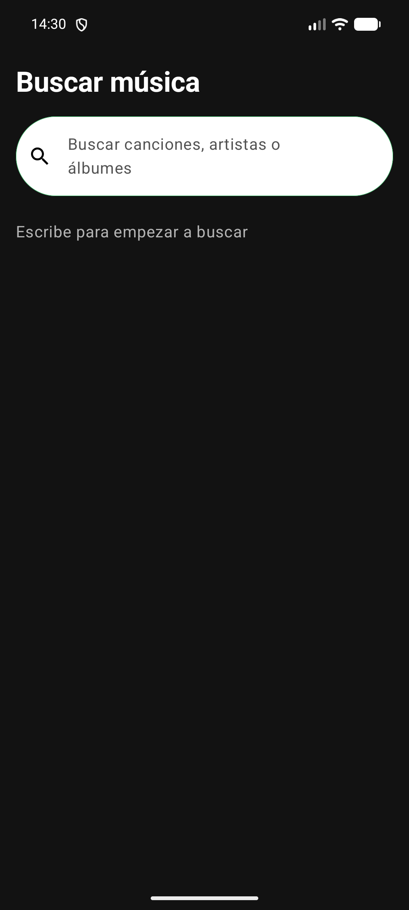 | 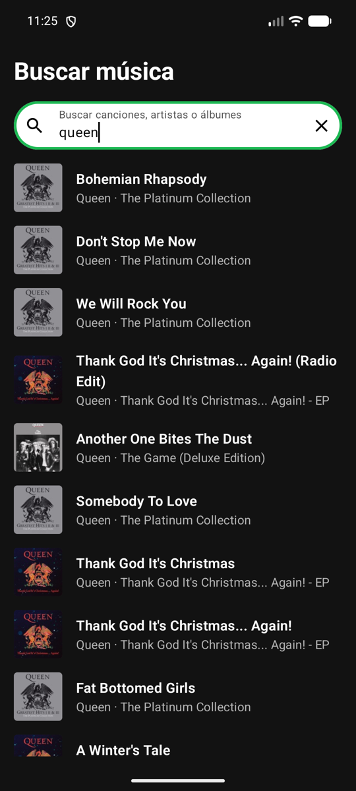 | 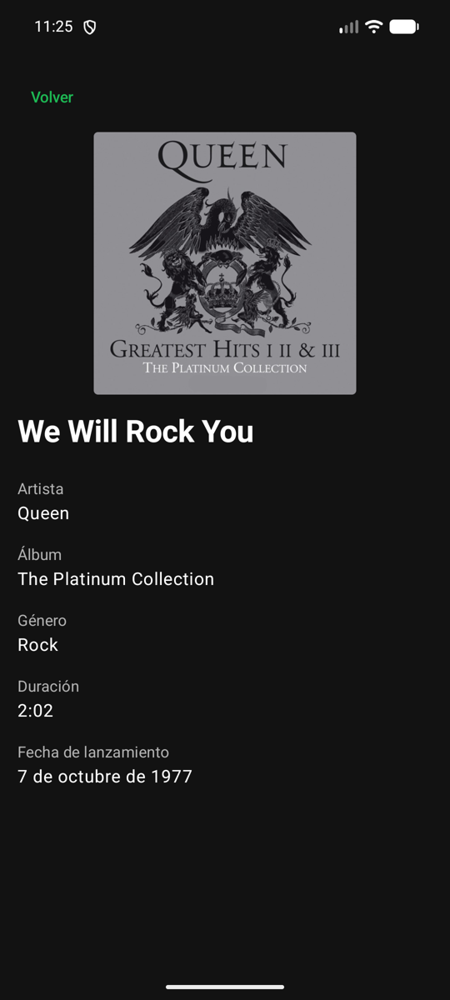 |

### Estados vacío y error

| 4. Sin resultados | 5. Sin conexión |
|---|---|
| 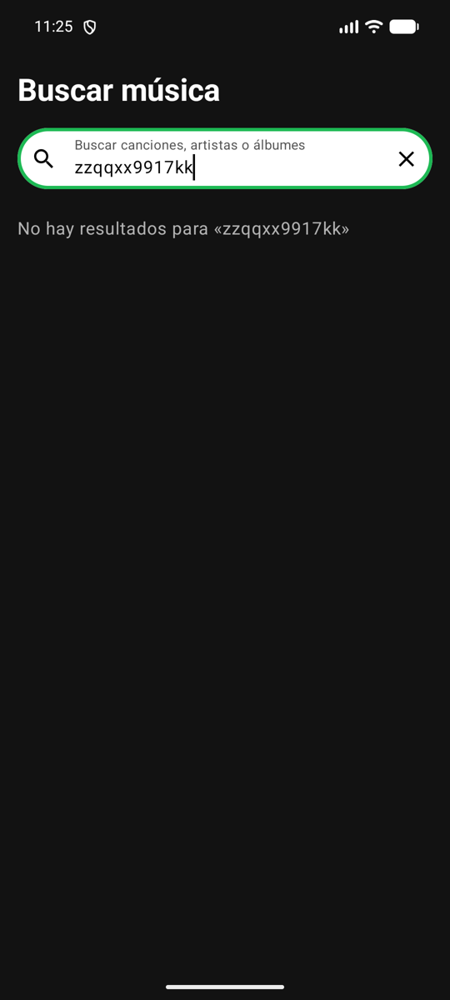 | 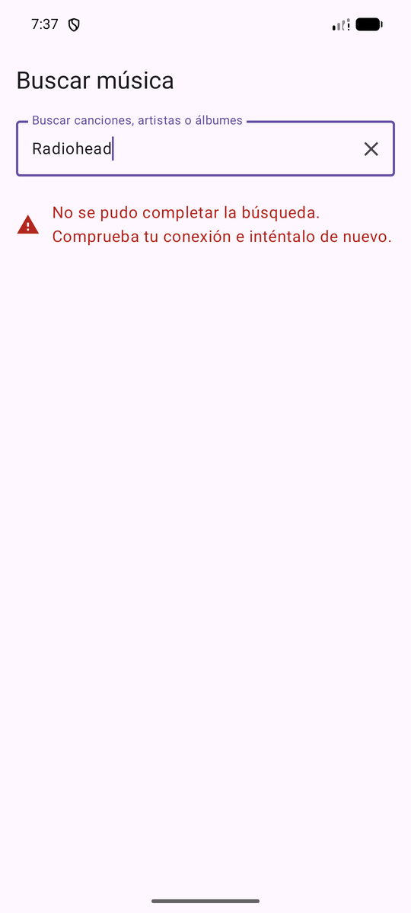 |

El mensaje de vacío cita lo buscado. El de error lleva icono y texto, y se reintenta con el botón
«Reintentar» (área táctil de 48 dp) o con la tecla de búsqueda del teclado.

### Fuente al 200 %

| 6. Lista al 200 % | 7. Detalle al 200 % | 8. Detalle al 200 % (scroll) |
|---|---|---|
| 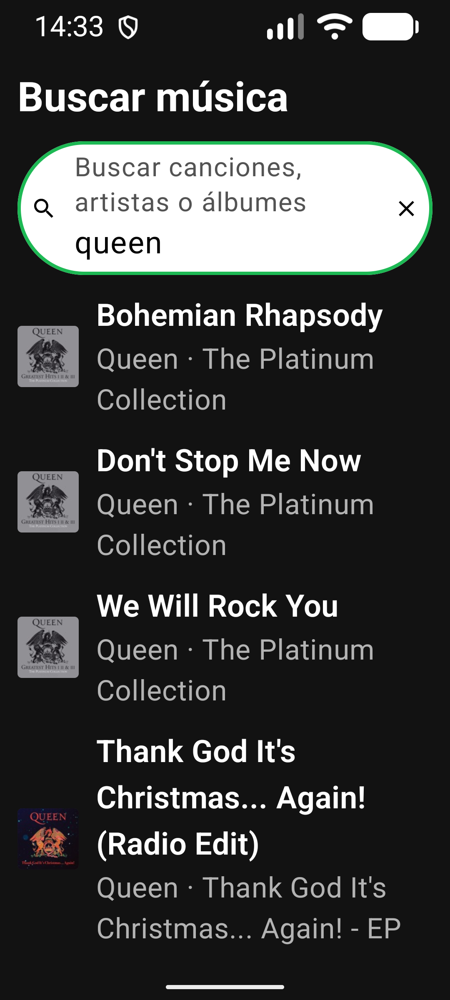 | 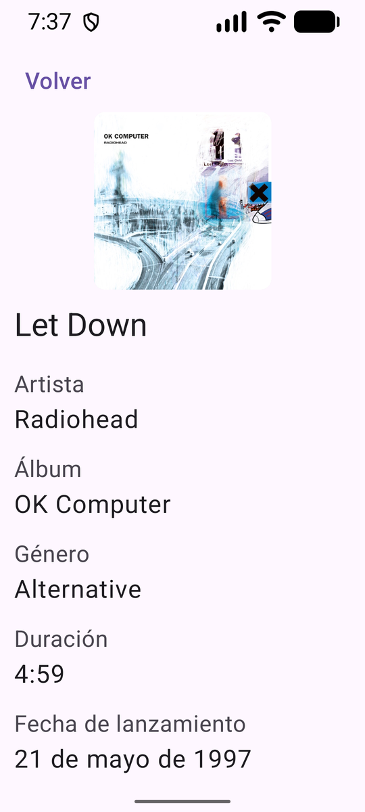 | 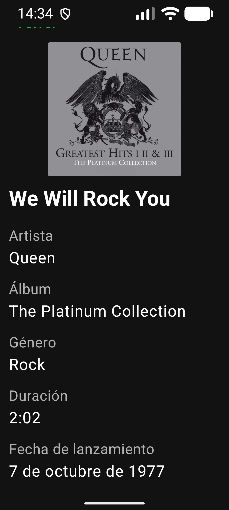 |

### Contraste

Ratios de contraste de la paleta (fórmula WCAG; el mínimo para texto es 4,5:1 y para bordes e
iconos, 3:1). Los comprueba `IberiaPaletteTest`, así que un cambio de color que baje de ese mínimo
rompe los tests.

| Elemento | Texto | Fondo | Ratio |
|---|---|---|---|
| Títulos | `#FFFFFF` | `#121212` | 18,7:1 |
| Subtítulos y etiquetas de campo | `#B3B3B3` | `#121212` | 8,9:1 |
| Subtítulos sobre superficie elevada | `#B3B3B3` | `#282828` | 7,0:1 |
| Acento verde («Volver») | `#1DB954` | `#121212` | 7,2:1 |
| Mensaje de error | `#F3727F` | `#121212` | 6,7:1 |
| Texto sobre el acento verde | `#000000` | `#1DB954` | 8,1:1 |
| Texto del buscador | `#000000` | `#FFFFFF` | 21,0:1 |
| Etiqueta del buscador | `#535353` | `#FFFFFF` | 7,7:1 |
| Borde y separadores | `#727272` | `#121212` | 3,9:1 |

### TalkBack

Con TalkBack activado; el recuadro verde es su foco, es decir, lo que leería.

| 9. Título | 10. Campo | 11. Detalle |
|---|---|---|
| 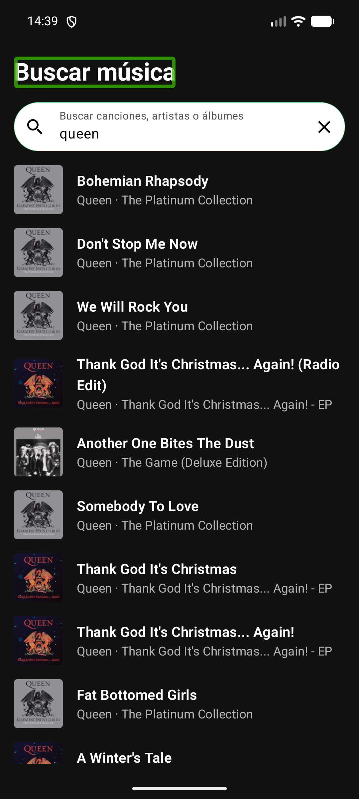 | 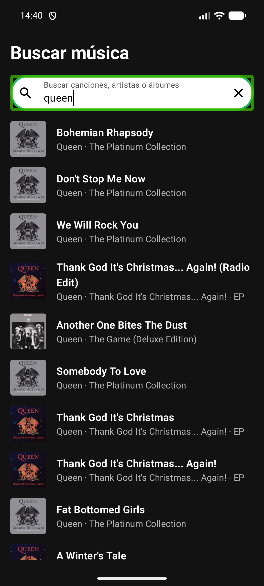 | 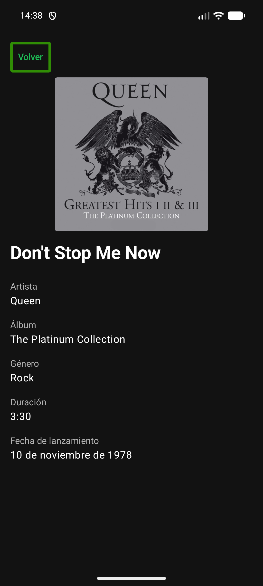 |
| Encabezado (`heading()`). | Etiqueta visible; el teclado muestra la tecla de búsqueda. | Al abrir el detalle, el foco empieza en «Volver». |

No hay capturas del foco sobre cada fila ni sobre el botón de borrar: en el emulador usado, TalkBack
no permitió moverse entre elementos de forma fiable. Esa semántica (cada fila y cada campo como un
único elemento, el botón de borrar con descripción) la comprueban los tests de accesibilidad.

## Flujo de trabajo

Una rama por paso desde `develop`, commits pequeños con Conventional Commits y una PR a `develop`
por rama. El CI ejecuta `ktfmtCheck` y `test` en cada PR hacia `develop`.

Las PR usan la plantilla `.github/pull_request_template.md`, que incluye una lista de comprobación
de tests y de accesibilidad.

## Licencia

El repositorio no incluye un archivo de licencia.
